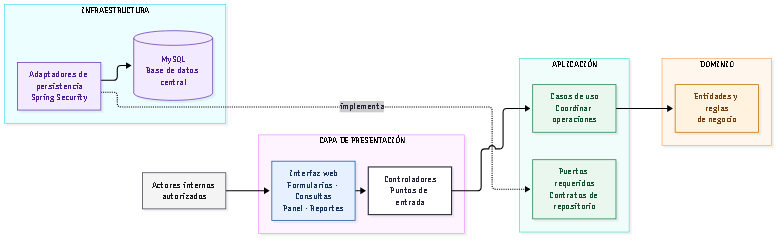

# Arquitectura inicial del sistema

## 1. Propósito

Este documento presenta una arquitectura inicial para el sistema de gestión de
una empresa constructora. La propuesta organiza las responsabilidades de la
solución y explica cómo se relacionan sus componentes. No constituye un diseño
detallado de implementación ni introduce funcionalidades fuera del alcance
documentado.

## 2. Enfoque arquitectónico

Se propone una **arquitectura web con Clean Architecture** para una aplicación
de gestión centralizada. La solución se organiza como monolito modular y
separa Presentación, Aplicación, Dominio e Infraestructura. El objetivo es que
las reglas y los casos de uso no dependan de la interfaz web, de Spring ni de
MySQL, de modo que los detalles técnicos puedan cambiar sin obligar a modificar
el núcleo del sistema.

La propuesta considera una aplicación central que atiende las solicitudes de
los usuarios desde un navegador y utiliza una base de datos centralizada. No se
plantea una arquitectura de microservicios ni una integración distribuida,
porque el caso no establece una necesidad que las justifique.

## 3. Capas y responsabilidades

### 3.1 Presentación

Es la interfaz web utilizada por los actores internos autorizados. Presenta
formularios, consultas y vistas para:

- proyectos y actividades;
- avance de obras;
- materiales y almacén;
- personal y asignaciones;
- maquinaria y estado o asignación de equipos;
- presupuestos y gastos;
- panel principal y reportes;
- administración de usuarios y roles.

La presentación recopila las solicitudes del usuario, las convierte al formato
esperado por los casos de uso y presenta sus resultados. No contiene reglas de
negocio ni accede directamente a la base de datos.

### 3.2 Aplicación

Coordina los casos de uso del sistema y declara los puertos que estos necesitan
para interactuar con el exterior. Puede organizarse en módulos funcionales:

- **Proyectos y actividades:** administración de proyectos, registro de
  actividades y actualización del avance.
- **Materiales y almacén:** catálogo de materiales, entradas, salidas y consulta
  de existencias.
- **Personal:** registro de trabajadores y asignación a proyectos o actividades.
- **Maquinaria:** registro de equipos y control de estado y asignación.
- **Finanzas:** presupuesto y gastos asociados a los proyectos.
- **Reportes e información general:** consultas consolidadas para reportes y
  panel principal.
- **Usuarios y roles:** administración de cuentas, roles y permisos.

Los controladores o puntos de entrada reciben las solicitudes web y delegan su
procesamiento en los casos de uso. La aplicación valida el flujo y coordina
operaciones, pero las reglas que definen la validez del negocio pertenecen al
Dominio.

### 3.3 Dominio

Contiene los conceptos, entidades y reglas que expresan el negocio: proyectos,
actividades, movimientos de almacén, trabajadores, asignaciones, equipos,
presupuestos, gastos, usuarios y roles, según se precisen durante el diseño.
Sus reglas no dependen de Spring, HTTP, SQL ni de los casos de uso concretos.

### 3.4 Infraestructura

Implementa los puertos declarados por Aplicación y conecta el núcleo con
detalles externos: adaptadores de persistencia y MySQL, integración con Spring
Boot y mecanismos técnicos de autenticación. Almacena la información central
del sistema en una base de datos relacional. Los registros deben permitir
relacionar proyectos con sus actividades, recursos, movimientos de materiales,
asignaciones y datos financieros.

La integridad referencial y las transacciones respaldan las reglas del dominio,
pero no las reemplazan. La estrategia y frecuencia de copias de seguridad
deberán acordarse como parte de la operación del sistema.

## 4. Componentes y comunicación

El flujo normal de una operación es el siguiente:

1. Un usuario autorizado interactúa con la interfaz web.
2. La interfaz envía una solicitud al controlador correspondiente.
3. El controlador delega el caso de uso en un servicio de aplicación.
4. El caso de uso coordina la operación y solicita al Dominio validar sus
   reglas.
5. Cuando necesita leer o persistir información, invoca un puerto declarado
   hacia adentro; el adaptador de Infraestructura implementa ese puerto.
6. El adaptador opera sobre la base de datos relacional.
7. El resultado vuelve por las capas de Aplicación y Presentación.

La dirección de dependencias en el código apunta hacia el Dominio y los
contratos internos. La llamada en tiempo de ejecución a un adaptador no
significa que el caso de uso dependa de su implementación concreta.

La autenticación y la autorización por roles son preocupaciones transversales.
La identidad y los permisos se verifican en el servidor para cada operación
protegida, no solo ocultando opciones en la interfaz. Spring Security es el
mecanismo técnico previsto; las políticas que condicionan cada caso de uso
deben permanecer independientes del framework.

## 5. Diagrama arquitectónico

Fuente Mermaid editable: [arquitectura-inicial.mmd](../../img/fuentes/arquitectura-inicial.mmd).

El diagrama editable de draw.io está disponible en
[arquitectura-inicial.drawio](../../img/fuentes/arquitectura-inicial.drawio).

## 6. Persistencia e integridad

La persistencia centralizada permitirá que los módulos consulten datos
relacionados sin mantener registros independientes por área. Las entidades de
proyecto actuarán como referencia para las actividades y los recursos asociados
cuando corresponda. Los movimientos de almacén deberán reflejarse en las
existencias; los avances, en el seguimiento del proyecto; y los gastos, en la
información financiera de la obra.

Las operaciones que modifiquen información relacionada deberán validarse y
guardarse de manera consistente para evitar registros parciales. Las reglas
específicas de cálculo de avance, stock o costos deberán precisarse durante el
diseño detallado; este documento no presupone fórmulas que el caso no define.

## 7. Relación con los drivers arquitectónicos

| Driver | Respuesta en la arquitectura |
|---|---|
| DA01. Integrar proyectos y recursos | Los módulos de negocio relacionan actividades, materiales, personal, maquinaria y finanzas con sus proyectos. |
| DA02. Proteger el acceso | El control por roles se aplica transversalmente y las operaciones protegidas verifican permisos en la capa de aplicación. |
| DA03. Preservar integridad y trazabilidad | Los casos de uso coordinan las reglas del Dominio y los adaptadores y la base de datos mantienen relaciones consistentes. |
| DA04. Proporcionar información oportuna | Los componentes de reportes y panel consultan los módulos de origen mediante casos de uso y puertos definidos. |
| DA05. Facilitar mantenimiento | Las cuatro capas y los módulos delimitan responsabilidades; las dependencias hacia adentro aíslan el núcleo de los cambios técnicos. |
| DA06. Centralizar y recuperar información | La solución utiliza una persistencia centralizada; la operación deberá establecer y probar respaldos. |
| DA07. Permitir crecimiento | Los módulos y los puertos entre capas permiten incorporar cambios sin convertir cada ampliación en una reestructuración completa. |
| DA08. Respetar el contexto tecnológico | El enfoque web y las tecnologías Java, Spring Boot, Spring Security y MySQL son compatibles con la propuesta tecnológica del caso, pendientes de confirmación final. |

## 8. Tecnologías previstas y decisiones pendientes

La propuesta tecnológica inicial contempla:

- **Backend:** Java con Spring Boot.
- **Interfaz web:** HTML, CSS, JavaScript y Bootstrap.
- **Autenticación y autorización:** Spring Security.
- **Persistencia:** MySQL.

Estas tecnologías proceden de la propuesta del caso y deberán validarse con las
condiciones del curso, la experiencia del equipo y el entorno de despliegue.
Quedan pendientes de definición el alojamiento, la configuración de respaldos,
el dimensionamiento de infraestructura y las reglas detalladas de cálculo y
validación de cada módulo.
