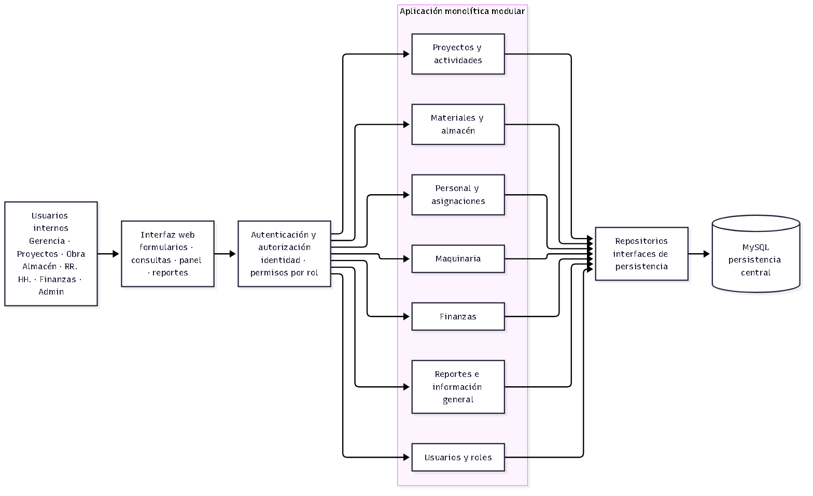

# Componentes arquitectónicos

## Propósito y alcance

Este documento descompone la propuesta de arquitectura inicial en
responsabilidades que colaboran dentro de una sola aplicación web. El diagrama
es una vista lógica editable en Mermaid; no representa una infraestructura ya
desplegada.

## Vista de componentes

Fuente Mermaid editable: [arquitectura-componentes.mmd](../../img/fuentes/arquitectura-componentes.mmd).

## Responsabilidades y límites

| Componente | Responsabilidad | No debe |
|---|---|---|
| Interfaz web | Capturar solicitudes, mostrar consultas y comunicar resultados y errores. | Ser la única barrera de autorización o implementar reglas de negocio críticas. |
| Autenticación y autorización | Identificar al usuario y verificar permisos para cada operación protegida. | Confiar solo en opciones ocultas de la interfaz. |
| Proyectos y actividades | Administrar obras, actividades y sus avances. | Mantener copias independientes de los datos de otros módulos. |
| Materiales y almacén | Administrar materiales, movimientos y existencias por proyecto. | Confirmar una salida que deje existencias inválidas. |
| Personal y asignaciones | Administrar trabajadores y sus asignaciones a obras o actividades. | Definir reglas de maquinaria o presupuestos. |
| Maquinaria | Administrar equipos, estado y asignación. | Incorporar telemetría física, excluida del alcance inicial. |
| Finanzas | Administrar presupuestos y gastos asociados a proyectos. | Sustituir un sistema contable o emitir comprobantes externos. |
| Reportes e información general | Consolidar datos ya gestionados por los módulos para reportes y panel. | Convertirse en una segunda fuente de verdad. |
| Usuarios y roles | Administrar cuentas y roles del sistema. | Decidir permisos únicamente desde el cliente web. |
| Repositorios | Exponer operaciones de lectura y escritura usadas por los casos de uso. | Contener reglas propias de los procesos de negocio. |
| MySQL | Conservar los datos relacionales y aplicar integridad referencial y transacciones. | Ser accedida directamente desde la interfaz. |

## Colaboración de ejemplo: registrar una salida de almacén

1. El encargado de almacén solicita registrar una salida para un proyecto.
2. La autorización valida que su rol permita esa operación.
3. El caso de uso valida cantidad, material, proyecto y stock disponible.
4. El repositorio guarda el movimiento y actualiza las existencias en una
   transacción.
5. La interfaz muestra la confirmación solo si la persistencia termina con
   éxito; ante un error, informa el fallo y no presenta una salida como
   confirmada.

Las reglas detalladas para anulación de movimientos, reservas, múltiples
almacenes o concurrencia deben acordarse antes de implementar el flujo real.

## Reglas de dependencia

- La interfaz depende de casos de uso, no de consultas SQL ni de MySQL.
- Los casos de uso dependen de contratos de repositorio y reglas del dominio.
- Los adaptadores de persistencia implementan esos contratos.
- Los módulos comparten identificadores y contratos explícitos; no deben
  invocar directamente detalles internos de otros módulos.
- La autorización se aplica en el servidor para todas las operaciones
  protegidas.

## Trazabilidad

La vista responde a los drivers DA01–DA08 y a las decisiones DA-001–DA-004.
Los módulos corresponden al alcance de RF01–RF16; el flujo de almacén se
relaciona especialmente con RF05–RF07 y AC04.
