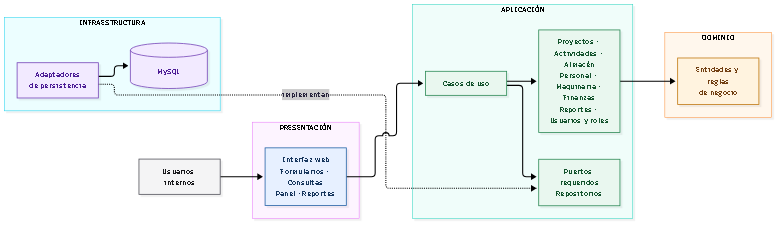

# Estilo arquitectónico

## Estilo propuesto

El sistema se propone como un **monolito modular que aplica Clean
Architecture**. Es una aplicación web desplegable como una unidad, cuyos
módulos mantienen responsabilidades diferenciadas dentro de cuatro capas con
límites explícitos. Esta es una propuesta inicial, no una decisión de
implementación irreversible.

## Capas

| Capa | Responsabilidad | Evita |
|---|---|---|
| Presentación | Exponer la interfaz web y los puntos de entrada; transformar solicitudes y resultados. | Contener reglas de negocio o acceder directamente a la persistencia. |
| Aplicación | Implementar casos de uso, coordinar el dominio y declarar los puertos requeridos por esos casos. | Depender de frameworks, protocolos de transporte o implementaciones concretas. |
| Dominio | Representar entidades, conceptos y reglas de negocio invariantes. | Depender de la aplicación, la interfaz, frameworks o tecnologías de persistencia. |
| Infraestructura | Implementar adaptadores para los puertos y conectar frameworks, seguridad y base de datos. | Ser fuente de reglas de negocio o ser invocada directamente por Presentación. |

Fuente Mermaid editable: [estilo-monolito-capas.mmd](../../img/fuentes/estilo-monolito-capas.mmd).

### Regla de dependencias

Las dependencias de código apuntan hacia adentro: Presentación invoca los
casos de uso de Aplicación; Aplicación utiliza el Dominio y define los puertos
que necesita; e Infraestructura implementa esos puertos. En tiempo de ejecución
un caso de uso puede invocar un puerto cuya implementación concreta está en
Infraestructura, pero el código de Aplicación no conoce ese adaptador. MySQL y
Spring son detalles reemplazables y no deben dictar las reglas del negocio.

## Módulos de negocio

- **Proyectos y actividades:** datos de proyectos, actividades y avance.
- **Materiales y almacén:** catálogo, movimientos y consulta de existencias.
- **Personal:** trabajadores y asignaciones.
- **Maquinaria:** equipos, estado y asignación.
- **Finanzas:** presupuestos y gastos asociados a proyectos.
- **Reportes e información general:** consultas consolidadas y panel principal.
- **Usuarios y roles:** cuentas, autenticación y permisos.

Los módulos deben colaborar a través de casos de uso, servicios de dominio o
contratos explícitos, según corresponda. Cuando una operación abarque datos
relacionados, la capa de aplicación debe coordinarla y el dominio proteger sus
invariantes. No se presupone una separación física de bases de datos.

## Mecanismos transversales

- **Autenticación y autorización:** validar la identidad y los permisos de cada
  operación protegida; ocultar una opción en la interfaz no sustituye la
  autorización del lado servidor.
- **Validación e integridad:** comprobar datos obligatorios, relaciones y reglas
  de dominio antes de persistir cambios.
- **Manejo de errores:** comunicar fallos de forma comprensible sin exponer
  detalles internos ni aparentar que una operación fallida tuvo éxito.
- **Observabilidad y recuperación:** definir registros operativos y respaldos
  verificables al concretar el entorno de despliegue.

## Correspondencia tecnológica prevista

La propuesta del caso contempla Java y Spring Boot para la aplicación,
Spring Security para el control de acceso, tecnologías web para la presentación
y MySQL para la persistencia. Estas tecnologías son compatibles con el estilo
propuesto si se mantienen en los límites de Presentación o Infraestructura,
pero deben confirmarse antes de considerarse restricciones definitivas.

## Consecuencias y riesgos

**Beneficios esperados**

- Despliegue y operación iniciales más sencillos que una solución distribuida.
- Límites de responsabilidad claros para los módulos y las capas.
- Consistencia transaccional más directa para procesos que relacionan varios
  registros.

**Riesgos a controlar**

- Un monolito puede convertirse en una estructura acoplada si los módulos
  comparten lógica o acceden entre sí sin interfaces.
- El crecimiento puede aumentar el impacto de despliegues coordinados.
- La concentración en una base de datos requiere respaldos, control de acceso y
  gestión cuidadosa de cambios de esquema.

Se deberá reconsiderar la distribución física si aparecen requisitos medibles
de escalado independiente, autonomía de equipos o disponibilidad por módulo.

## Referencias

- [Enfoque arquitectónico](./enfoque-arquitectonico.md)
- [Arquitectura inicial](./arquitectura-inicial.md)
- [Drivers arquitectónicos](../01-analisis-de-sistema/06-drivers-arquitectonicos.md)
