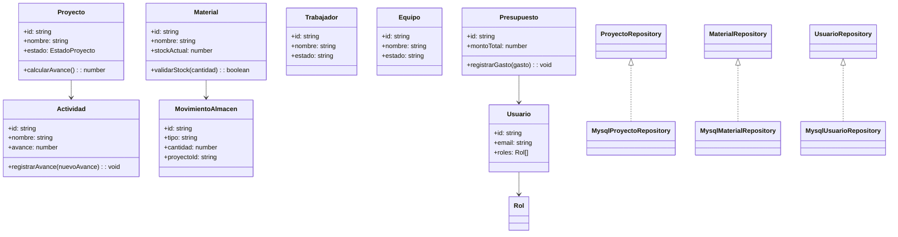
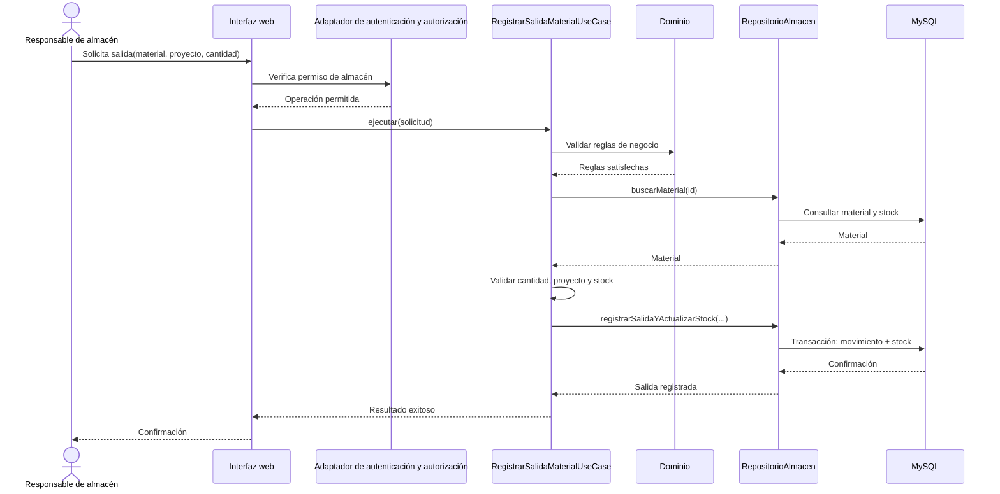

# Diseño interno de módulos

> **Proyecto:** Sistema de gestión de una empresa constructora
> **Backend:** Java + Spring Boot
> **Enfoque arquitectónico:** Clean Architecture dentro de cada módulo del monolito modular
> **Nivel C4:** 4 – Código · **Versión:** 1.0

---

## 1. Propósito

Este documento describe cómo se organiza el código dentro de cada módulo del
backend. Tiene tres objetivos:

- que todos los módulos se construyan con la misma estructura;
- que las reglas de negocio queden aisladas de la tecnología;
- que cualquier integrante del equipo sepa dónde va cada archivo y de qué puede depender.

## 2. Estructura de carpetas

```text
src/
└── modules/
    ├── proyectos/
    │   ├── dominio/
    │   │   ├── proyecto.ts
    │   │   ├── estado-proyecto.ts
    │   │   ├── proyecto-repository.ts
    │   │   └── proyecto-factory.ts
    │   ├── aplicacion/
    │   │   ├── registrar-proyecto.use-case.ts
    │   │   ├── actualizar-avance-proyecto.use-case.ts
    │   │   └── registrar-proyecto.command.ts
    │   ├── infraestructura/
    │   │   └── mysql-proyecto-repository.ts
    │   ├── presentacion/
    │   │   ├── proyecto.controller.ts
    │   │   └── proyectos.routes.ts
    │   ├── proyectos.module.ts
    │   └── index.ts
    │
    ├── actividades/
    │   ├── dominio/
    │   │   ├── actividad.ts
    │   │   ├── avance-actividad.ts
    │   │   ├── actividad-repository.ts
    │   │   └── actividad-factory.ts
    │   ├── aplicacion/
    │   │   ├── registrar-actividad.use-case.ts
    │   │   ├── actualizar-avance-actividad.use-case.ts
    │   │   └── registrar-actividad.command.ts
    │   ├── infraestructura/
    │   │   └── mysql-actividad-repository.ts
    │   ├── presentacion/
    │   │   ├── actividad.controller.ts
    │   │   └── actividades.routes.ts
    │   ├── actividades.module.ts
    │   └── index.ts
    │
    ├── materiales-y-almacen/
    │   ├── dominio/
    │   │   ├── material.ts
    │   │   ├── movimiento-almacen.ts
    │   │   ├── material-repository.ts
    │   │   └── salida-material.ts
    │   ├── aplicacion/
    │   │   ├── registrar-salida-material.use-case.ts
    │   │   ├── registrar-entrada-material.use-case.ts
    │   │   └── registrar-salida-material.command.ts
    │   ├── infraestructura/
    │   │   └── mysql-material-repository.ts
    │   ├── presentacion/
    │   │   ├── material.controller.ts
    │   │   └── materiales.routes.ts
    │   ├── materiales-y-almacen.module.ts
    │   └── index.ts
    │
    ├── personal/
    │   ├── dominio/
    │   │   ├── trabajador.ts
    │   │   ├── asignacion-trabajador.ts
    │   │   ├── trabajador-repository.ts
    │   │   └── trabajador-factory.ts
    │   ├── aplicacion/
    │   │   ├── registrar-trabajador.use-case.ts
    │   │   ├── asignar-trabajador.use-case.ts
    │   │   └── registrar-trabajador.command.ts
    │   ├── infraestructura/
    │   │   └── mysql-trabajador-repository.ts
    │   ├── presentacion/
    │   │   ├── personal.controller.ts
    │   │   └── personal.routes.ts
    │   ├── personal.module.ts
    │   └── index.ts
    │
    ├── maquinaria/
    │   ├── dominio/
    │   │   ├── equipo.ts
    │   │   ├── estado-equipo.ts
    │   │   ├── equipo-repository.ts
    │   │   └── asignacion-equipo.ts
    │   ├── aplicacion/
    │   │   ├── registrar-equipo.use-case.ts
    │   │   ├── actualizar-equipo.use-case.ts
    │   │   └── registrar-equipo.command.ts
    │   ├── infraestructura/
    │   │   └── mysql-equipo-repository.ts
    │   ├── presentacion/
    │   │   ├── maquinaria.controller.ts
    │   │   └── maquinaria.routes.ts
    │   ├── maquinaria.module.ts
    │   └── index.ts
    │
    ├── finanzas/
    │   ├── dominio/
    │   │   ├── presupuesto.ts
    │   │   ├── gasto.ts
    │   │   ├── finanzas-repository.ts
    │   │   └── presupuesto-factory.ts
    │   ├── aplicacion/
    │   │   ├── registrar-presupuesto.use-case.ts
    │   │   ├── registrar-gasto.use-case.ts
    │   │   └── registrar-gasto.command.ts
    │   ├── infraestructura/
    │   │   └── mysql-finanzas-repository.ts
    │   ├── presentacion/
    │   │   ├── finanzas.controller.ts
    │   │   └── finanzas.routes.ts
    │   ├── finanzas.module.ts
    │   └── index.ts
    │
    ├── reportes/
    │   ├── dominio/
    │   │   ├── reporte-resumen.ts
    │   │   ├── reporte-query.ts
    │   │   └── reporte-repository.ts
    │   ├── aplicacion/
    │   │   ├── generar-reporte-proyectos.use-case.ts
    │   │   ├── generar-reporte-financiero.use-case.ts
    │   │   └── reporte-query.command.ts
    │   ├── infraestructura/
    │   │   └── mysql-reporte-repository.ts
    │   ├── presentacion/
    │   │   ├── reporte.controller.ts
    │   │   └── reportes.routes.ts
    │   ├── reportes.module.ts
    │   └── index.ts
    │
    └── usuarios-y-roles/
        ├── dominio/
        │   ├── usuario.ts
        │   ├── rol.ts
        │   ├── permiso.ts
        │   ├── usuario-repository.ts
        │   └── usuario-factory.ts
        ├── aplicacion/
        │   ├── crear-usuario.use-case.ts
        │   ├── asignar-rol.use-case.ts
        │   └── crear-usuario.command.ts
        ├── infraestructura/
        │   ├── mysql-usuario-repository.ts
        │   └── spring-security-adapter.ts
        ├── presentacion/
        │   ├── usuario.controller.ts
        │   └── usuarios.routes.ts
        ├── usuarios-y-roles.module.ts
        └── index.ts
```

## 3. Capas del módulo y regla de dependencia

| Capa | Contiene | Responsabilidad | Puede depender de | No puede depender de |
|---|---|---|---|---|
| Dominio | Entidades, objetos de valor, enumeraciones, puertos (interfaces) | Guardar las reglas del negocio que no cambian por tecnología | Nada externo | Express, Spring, MySQL, SDKs, infraestructura |
| Aplicación | Casos de uso, comandos y DTOs de entrada | Orquestar el flujo: qué paso va primero y qué hacer si falla | Dominio | Presentación, infraestructura concreta |
| Infraestructura | Repositorios concretos, adaptadores de servicios externos | Implementar los puertos del dominio con tecnología concreta | Dominio, librerías externas | A nivel de diseño, no debe decidir reglas del negocio |
| Presentación | Controladores, rutas, serialización HTTP | Traducir HTTP a llamadas del caso de uso y viceversa | Aplicación | Base de datos, SQL, librerías de DB |
| Composición | `*.module.ts`, `index.ts` | Crear instancias concretas e inyectarlas | Todas las capas | No aplica |

**Regla de dependencia:** el código solo puede importar hacia el centro (dominio). El dominio no conoce Express, MySQL ni Spring Security.

> Cómo comprobarlo en el código: basta revisar los imports de `dominio/`. Si aparece `express`, `mysql`, `spring`, `postgres` o cualquier archivo de `infraestructura/`, la regla se rompió.

## 4. Responsabilidades por módulo

| Módulo | Casos de uso principales | Conceptos del dominio | Dependencias permitidas |
|---|---|---|---|
| Proyectos | Registrar, modificar, consultar proyectos y revisar su estado. | Proyecto, estado de proyecto. | Puertos de Aplicación; consultas de avance mediante contratos explícitos. |
| Actividades | Registrar actividades y actualizar su avance. | Actividad, avance. | Proyecto mediante identificador y contrato definido. |
| Materiales y almacén | Registrar materiales, entradas, salidas y consultar stock. | Material, movimiento, tipo de movimiento. | Proyecto mediante identificador; puerto de persistencia declarado en Aplicación. |
| Personal | Administrar trabajadores y consultar sus asignaciones. | Trabajador, asignación. | Proyectos y actividades mediante identificadores y contratos definidos. |
| Maquinaria | Administrar equipos, su estado y asignación. | Equipo, estado, asignación. | Proyectos mediante identificador. |
| Finanzas | Registrar presupuesto y gastos por proyecto. | Presupuesto, gasto. | Proyecto mediante identificador. |
| Reportes e información general | Construir consultas de resumen y reportes basados en los módulos de origen. | Proyección de lectura. | Puertos de consulta; no es dueño de datos operativos. |
| Usuarios y roles | Administrar cuentas, roles y permisos. | Usuario, rol, permiso. | Políticas de autorización de Aplicación; adaptadores técnicos de autenticación en Infraestructura. |

## 5. Diagrama de clases



### 5.1 Notación UML utilizada

| Símbolo | Significado | Ejemplo |
|---|---|---|
| Línea continua con flecha abierta | Asociación: la clase guarda una referencia a la otra | `Proyecto` → `Actividad` |
| Línea discontinua con triángulo hueco | Realización: implementa una interfaz | `MysqlProyectoRepository` ▷ `ProyectoRepository` |
| `+` / `-` | Público / privado | `+calcularAvance()` |
| Nombre en cursiva + «interface» | Interfaz (contrato sin implementación) | `ProyectoRepository` |

## 6. Flujo de ejecución: registrar salida de material

### Entradas y resultados

- **Entrada:** identificador del material, identificador del proyecto, cantidad y usuario autenticado.
- **Resultado exitoso:** movimiento de salida registrado y existencias actualizadas.
- **Resultado rechazado:** error explícito para identificador inexistente, cantidad inválida, proyecto inválido o stock insuficiente.
- **Condición de consistencia:** registrar el movimiento y actualizar stock como una sola operación atómica.

### Colaboración



Si falla la validación o la transacción, el caso de uso devuelve un error
explícito. No debe notificarse éxito ni persistirse parcialmente el movimiento.

## 7. Puertos requeridos por Aplicación

Estos puertos mantienen los casos de uso independientes de los detalles de
persistencia; sus adaptadores concretos pertenecen a Infraestructura:

- `RepositorioAlmacen` es una interfaz de Aplicación; su adaptador implementa
  las operaciones sobre la persistencia.
- `RepositorioAlmacen.buscarMaterial(id)` devuelve el material o indica que no existe.
- `RepositorioAlmacen.registrarSalidaYActualizarStock(...)` persiste de forma
  atómica la salida y el nuevo stock.
- `RepositorioProyectos.existe(id)` permite verificar la referencia del proyecto.
- `RegistrarSalidaMaterialUseCase.ejecutar(solicitud)` coordina autorización del
  contexto de entrada, validaciones de dominio y persistencia. La autorización
  efectiva se valida en el servidor antes de ejecutar la operación.

Este contrato y el flujo descrito son propuestas de diseño. Aún no existe una
implementación del caso de uso ni un adaptador de persistencia. En una fase de
construcción, la persistencia deberá registrar el movimiento y actualizar el
stock en una misma transacción de base de datos.

## 8. Pruebas propuestas

1. Salida válida reduce stock y registra un movimiento asociado al proyecto.
2. Cantidad cero o negativa se rechaza sin alterar stock ni movimientos.
3. Stock insuficiente se rechaza sin alterar datos.
4. Material o proyecto inexistente se rechaza explícitamente.
5. Un fallo de persistencia no produce una confirmación de éxito ni un estado parcial.
6. Una solicitud sin permiso no ejecuta el caso de uso.
7. Un proyecto sin actividades o sin presupuesto debe reaccionar según la regla del negocio.
8. Un usuario sin rol adecuado no puede actualizar información de administración del sistema.

## 9. Relación con los actores del sistema

Los módulos están alineados con los actores funcionales del proyecto:

| Actor | Módulo(s) | Operaciones principales |
|---|---|---|
| Administrador del sistema | Usuarios y roles | Crear usuarios, asignar roles y permisos |
| Gerente general | Proyectos, reportes, finanzas | Consultar indicadores y decisiones estratégicas |
| Responsable de proyectos y obras | Proyectos, actividades, maquinaria | Registrar avances, coordinar recursos y supervisar ejecución |
| Responsable de almacén | Materiales y almacén | Entradas, salidas, stock y disponibilidad |
| Responsable de personal | Personal | Registrar personal y asignaciones |
| Responsable financiero | Finanzas | Presupuestos, gastos y reportes financieros |

Esto permite que cada módulo tenga un dueño funcional claro y que el diseño
interno respete los permisos del negocio sin mezclar responsabilidades.

## 10. Conclusión

La organización de cada módulo en dominio, aplicación, infraestructura y
presentación facilita la evolución del sistema, mantiene reglas de negocio
centradas y permite una implementación más segura y mantenible. El patrón es
aplicable a todos los módulos funcionales del sistema constructora: proyectos,
actividades, materiales y almacén, personal, maquinaria, finanzas, reportes y
usuarios y roles.
