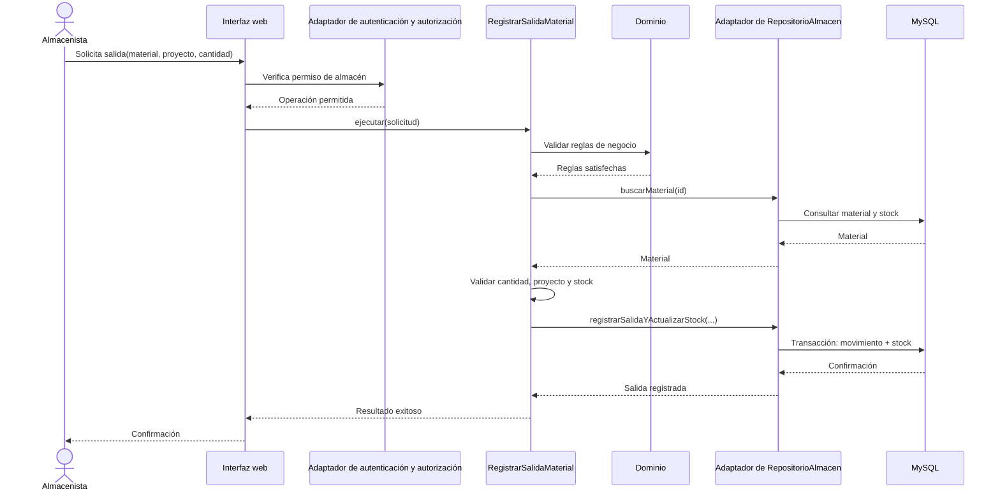

# Diseño interno de módulos

## Propósito

Definir responsabilidades internas iniciales para los módulos del sistema y
mostrar una colaboración detallada mediante el caso de uso de salida de
material. El diseño no establece todavía un esquema físico de base de datos ni
fórmulas de negocio que el caso no haya validado.

## Organización lógica

```text
presentacion/
  proyectos/
  actividades/
  almacen/
  personal/
  maquinaria/
  finanzas/
  reportes/
  usuarios/
aplicacion/
  proyectos/
  almacen/
  personal/
  maquinaria/
  finanzas/
  reportes/
  usuarios/
dominio/
  proyectos/
  almacen/
  personal/
  maquinaria/
  finanzas/
  usuarios/
infraestructura/
  persistencia/
  seguridad/
```

Esta estructura ilustra límites y no exige una distribución exacta de paquetes.
Los módulos permanecen dentro de una sola aplicación y una persistencia
centralizada. Los puertos de persistencia pertenecen a `aplicacion/`; sus
implementaciones se ubican en `infraestructura/persistencia/`. El dominio no
depende de los adaptadores ni de las tecnologías externas.

## Responsabilidades por módulo

| Módulo | Casos de uso principales | Conceptos del dominio | Dependencias permitidas |
|---|---|---|---|
| Proyectos | Registrar, modificar, consultar proyectos y revisar su estado. | Proyecto, estado de proyecto. | Puertos de Aplicación; consulta de avances y resúmenes mediante contratos explícitos. |
| Actividades | Registrar actividades y actualizar su avance. | Actividad, avance. | Proyecto mediante identificador y contrato definido. |
| Materiales y almacén | Registrar materiales, entradas, salidas y consultar stock. | Material, movimiento, tipo de movimiento. | Proyecto mediante identificador; puerto de persistencia declarado en Aplicación. |
| Personal | Administrar trabajadores y consultar sus asignaciones. | Trabajador, asignación. | Proyectos y actividades mediante identificadores y contratos definidos. |
| Maquinaria | Administrar equipos, su estado y asignación. | Equipo, estado, asignación. | Proyectos mediante identificador. |
| Finanzas | Registrar presupuesto y gastos por proyecto. | Presupuesto, gasto. | Proyecto mediante identificador. |
| Reportes e información general | Construir consultas de resumen y reportes basados en los módulos de origen. | Proyecciones de lectura. | Puertos de consulta; no es dueño de datos operativos. |
| Usuarios y roles | Administrar cuentas y asignación de roles. | Usuario, rol, permiso. | Políticas de autorización de Aplicación; adaptadores técnicos de autenticación en Infraestructura. |

Los casos de uso dependen de puertos definidos en Aplicación y de reglas del
Dominio. Infraestructura implementa esos puertos; no se invierten las
dependencias para hacer que el núcleo conozca MySQL o Spring.

Los conceptos son candidatos para el diseño detallado; sus atributos,
relaciones, estados válidos y reglas finales deben validarse con los
responsables. La estructura lógica anterior es documentación arquitectónica,
no carpetas de código ya implementadas.

## Caso de uso: registrar salida de material

### Entradas y resultados

- **Entrada:** identificador del material, identificador del proyecto,
  cantidad y usuario autenticado.
- **Resultado exitoso:** movimiento de salida registrado y existencias
  actualizadas.
- **Resultado rechazado:** error explícito para identificador inexistente,
  cantidad inválida, proyecto inválido o stock insuficiente.
- **Condición de consistencia:** registrar el movimiento y actualizar stock
  como una única operación atómica.

### Colaboración



Si falla la validación o la transacción, el caso de uso devuelve un resultado
de error explícito. No debe notificarse éxito ni persistirse parcialmente el
movimiento.

## Puertos requeridos por Aplicación

Estos puertos mantienen los casos de uso independientes de los detalles de
persistencia; sus adaptadores concretos pertenecen a Infraestructura:

- `RepositorioAlmacen` es una interfaz de Aplicación; su adaptador implementa
  las operaciones sobre la persistencia.
- `RepositorioAlmacen.buscarMaterial(id)` devuelve el material o indica que
  no existe.
- `RepositorioAlmacen.registrarSalidaYActualizarStock(...)` persiste de forma
  atómica la salida y el nuevo stock.
- `RepositorioProyectos.existe(id)` permite verificar la referencia del
  proyecto.
- `RegistrarSalidaMaterial.ejecutar(solicitud)` coordina autorización del
  contexto de entrada, validaciones de dominio y persistencia; la autorización
  efectiva se valida en el servidor antes de ejecutar la operación.

Este contrato y el flujo descrito son propuestas de diseño. Aún no existe una
implementación del caso de uso ni un adaptador de persistencia. En una fase de
construcción, la persistencia deberá registrar el movimiento y actualizar el
stock en una misma transacción de base de datos.

## Pruebas propuestas

1. Salida válida reduce stock y registra un movimiento asociado al proyecto.
2. Cantidad cero o negativa se rechaza sin alterar stock ni movimientos.
3. Stock insuficiente se rechaza sin alterar datos.
4. Material o proyecto inexistente se rechaza explícitamente.
5. Un fallo de persistencia no produce una confirmación de éxito ni un estado
   parcial.
6. Una solicitud sin permiso no ejecuta el caso de uso.
