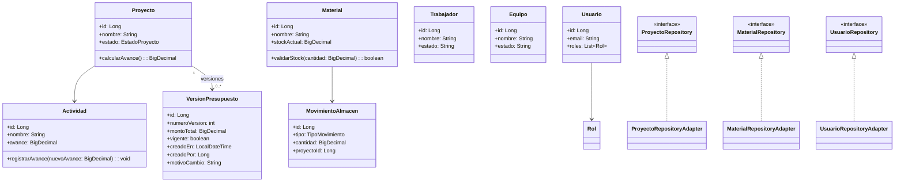
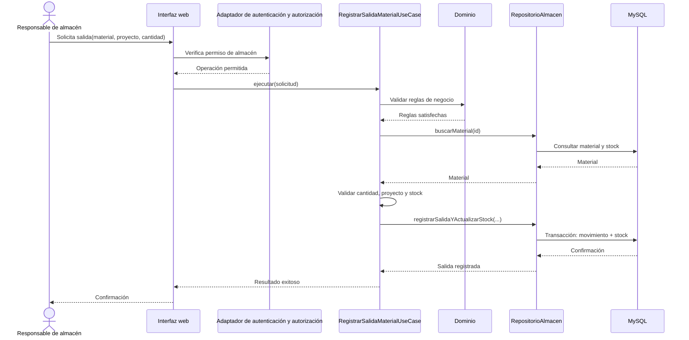

# Diseño interno de módulos

> **Proyecto:** Sistema de gestión de una empresa constructora
> **Backend:** Java + Spring Boot
> **Enfoque arquitectónico:** Clean Architecture dentro de cada módulo del monolito modular
> **Nivel C4:** 4 – Código · **Versión:** 1.0

---

## 1. Propósito

Este documento describe cómo se organiza el código dentro de cada módulo del
backend. Tiene tres objetivos:

- que todos los módulos se construyan con la misma estructura;
- que las reglas de negocio queden aisladas de la tecnología;
- que cualquier integrante del equipo sepa dónde va cada archivo y de qué puede depender.

## 2. Estructura de carpetas

```text
src/main/java/com/constructora/
├── configuracion/
│   └── seguridad/
│       └── SeguridadConfiguracion.java
└── modulos/
    ├── proyectos/
    ├── actividades/
    ├── materialesyalmacen/
    ├── personal/
    ├── maquinaria/
    ├── finanzas/
    ├── reportes/
    └── usuariosyroles/
```

Cada módulo mantiene la misma estructura Java:

```text
<modulo>/
├── dominio/                         # Entidades y reglas del negocio
├── aplicacion/
│   ├── caso/                        # Casos de uso
│   ├── dto/                         # Datos de entrada y salida
│   └── puerto/
│       ├── entrada/                 # Contratos de casos de uso
│       └── salida/                  # Interfaces de repositorio y otros puertos
├── infraestructura/
│   ├── persistencia/                # Adaptadores y entidades JPA
│   └── configuracion/               # Ensamblado e inyección de dependencias
└── presentacion/                    # Controladores y DTO HTTP
```

Por ejemplo, `ProyectoRepository` se define en
`proyectos.aplicacion.puerto.salida`; `ProyectoRepositoryAdapter`, junto con
el repositorio Spring Data/JPA que utiliza, pertenece a
`proyectos.infraestructura.persistencia`. Los paquetes de infraestructura
implementan los contratos de Aplicación y contienen las dependencias de Spring
Data/MySQL. Los nombres de paquetes pueden ajustarse al construir el proyecto,
sin cambiar esta dirección de dependencias.

## 3. Capas del módulo y regla de dependencia

| Capa | Contiene | Responsabilidad | Puede depender de | No puede depender de |
|---|---|---|---|---|
| Dominio | Entidades, objetos de valor, enumeraciones y reglas | Mantener invariantes del negocio independientes de la tecnología. | Tipos del propio Dominio. | Aplicación, Presentación, Infraestructura, Spring, JPA, MySQL y HTTP. |
| Aplicación | Casos de uso, DTOs y puertos de entrada/salida; aquí se definen las interfaces de repositorio. | Coordinar operaciones y declarar las dependencias requeridas por los casos de uso. | Dominio. | Presentación y adaptadores concretos de Infraestructura. |
| Infraestructura | Adaptadores de repositorio, entidades JPA y configuración técnica. | Implementar los puertos de Aplicación y conectar con Spring, JPA y MySQL. | Aplicación, Dominio y librerías externas. | No debe ser dueña de reglas de negocio ni cambiar el contrato de los puertos. |
| Presentación | Controladores y DTOs HTTP. | Traducir solicitudes/respuestas web y delegar en casos de uso. | Aplicación y mecanismos de seguridad configurados para la entrada. | Persistencia, SQL y adaptadores concretos. |
| Composición | Configuración Java/Spring que conecta interfaces e implementaciones. | Construir e inyectar los adaptadores concretos requeridos por los casos de uso. | Todas las capas. | No aplica. |

**Regla de dependencia:** Presentación depende de Aplicación; Aplicación
depende del Dominio y declara los puertos que necesita; Infraestructura
implementa esos puertos. La configuración de composición conecta las
implementaciones. El Dominio no conoce Spring, JPA, MySQL ni HTTP.

> Cómo comprobarlo en el código: revisar que los paquetes de `dominio` no
> importen clases externas y que los casos de uso dependan de interfaces
> declaradas en `aplicacion.puerto`, no de adaptadores de persistencia.

## 4. Responsabilidades por módulo

| Módulo | Casos de uso principales | Conceptos del dominio | Dependencias permitidas |
|---|---|---|---|
| Proyectos | Registrar, modificar, consultar proyectos y revisar su estado. | Proyecto, estado de proyecto. | Puertos de Aplicación; consultas de avance mediante contratos explícitos. |
| Actividades | Registrar actividades y actualizar su avance. | Actividad, avance. | Proyecto mediante identificador y contrato definido. |
| Materiales y almacén | Registrar materiales, entradas, salidas y consultar stock. | Material, movimiento, tipo de movimiento. | Proyecto mediante identificador; puerto de persistencia declarado en Aplicación. |
| Personal | Administrar trabajadores y consultar sus asignaciones. | Trabajador, asignación. | Proyectos y actividades mediante identificadores y contratos definidos. |
| Maquinaria | Administrar equipos, su estado y asignación. | Equipo, estado, asignación. | Proyectos mediante identificador. |
| Finanzas | Registrar gastos y crear nuevas versiones del presupuesto; consultar la versión vigente y el historial. | Versión de presupuesto, gasto. | Proyecto mediante identificador; el presupuesto mantiene su historial dentro del proyecto. |
| Reportes e información general | Construir consultas de resumen y reportes basados en los módulos de origen. | Proyección de lectura. | Puertos de consulta; no es dueño de datos operativos. |
| Usuarios y roles | Administrar cuentas, roles y permisos. | Usuario, rol, permiso. | Políticas de autorización de Aplicación; adaptadores técnicos de autenticación en Infraestructura. |

## 5. Diagrama de clases



Cada registro de `VersionPresupuesto` representa una versión inmutable del
presupuesto de su proyecto. La versión inicial recibe el número 1; cada cambio
crea la siguiente versión, y como máximo una queda marcada como vigente.

### 5.1 Notación UML utilizada

| Símbolo | Significado | Ejemplo |
|---|---|---|
| Línea continua con flecha abierta | Asociación: la clase guarda una referencia a la otra | `Proyecto` → `Actividad` |
| Línea discontinua con triángulo hueco | Realización: un adaptador implementa una interfaz | `ProyectoRepositoryAdapter` ▷ `ProyectoRepository` (puerto de Aplicación) |
| `+` / `-` | Público / privado | `+calcularAvance()` |
| Nombre en cursiva + «interface» | Interfaz (contrato sin implementación) | `ProyectoRepository` |

## 6. Flujo de ejecución: registrar salida de material

### Entradas y resultados

- **Entrada:** identificador del material, identificador del proyecto, cantidad y usuario autenticado.
- **Resultado exitoso:** movimiento de salida registrado y existencias actualizadas.
- **Resultado rechazado:** error explícito para identificador inexistente, cantidad inválida, proyecto inválido o stock insuficiente.
- **Condición de consistencia:** registrar el movimiento y actualizar stock como una sola operación atómica.

### Colaboración



Si falla la validación o la transacción, el caso de uso devuelve un error
explícito. No debe notificarse éxito ni persistirse parcialmente el movimiento.

## 7. Puertos requeridos por Aplicación

Estos puertos mantienen los casos de uso independientes de los detalles de
persistencia; sus adaptadores concretos pertenecen a Infraestructura:

- `RepositorioAlmacen` es una interfaz de Aplicación; su adaptador implementa
  las operaciones sobre la persistencia.
- `RepositorioAlmacen.buscarMaterial(id)` devuelve el material o indica que no existe.
- `RepositorioAlmacen.registrarSalidaYActualizarStock(...)` persiste de forma
  atómica la salida y el nuevo stock.
- `RepositorioProyectos.existe(id)` permite verificar la referencia del proyecto.
- `RegistrarSalidaMaterialUseCase.ejecutar(solicitud)` coordina autorización del
  contexto de entrada, validaciones de dominio y persistencia. La autorización
  efectiva se valida en el servidor antes de ejecutar la operación.

Este contrato y el flujo descrito son propuestas de diseño. Aún no existe una
implementación del caso de uso ni un adaptador de persistencia. En una fase de
construcción, la persistencia deberá registrar el movimiento y actualizar el
stock en una misma transacción de base de datos.

## 8. Pruebas propuestas

1. Salida válida reduce stock y registra un movimiento asociado al proyecto.
2. Cantidad cero o negativa se rechaza sin alterar stock ni movimientos.
3. Stock insuficiente se rechaza sin alterar datos.
4. Material o proyecto inexistente se rechaza explícitamente.
5. Un fallo de persistencia no produce una confirmación de éxito ni un estado parcial.
6. Una solicitud sin permiso no ejecuta el caso de uso.
7. Un proyecto sin actividades o sin presupuesto debe reaccionar según la regla del negocio.
8. Un usuario sin rol adecuado no puede actualizar información de administración del sistema.

## 9. Relación con los actores del sistema

Los módulos están alineados con los actores funcionales del proyecto:

| Actor | Módulo(s) | Operaciones principales |
|---|---|---|
| Administrador del sistema | Usuarios y roles | Crear usuarios, asignar roles y permisos |
| Gerente general | Proyectos, reportes, finanzas | Consultar indicadores y reportes consolidados de todas las áreas |
| Responsable de proyectos y obras | Proyectos, actividades, maquinaria | Registrar avances, coordinar recursos y supervisar ejecución |
| Responsable de almacén | Materiales y almacén, reportes | Entradas, salidas, stock y reportes de materiales |
| Responsable de personal | Personal, reportes | Registrar personal, gestionar asignaciones y consultar reportes de personal |
| Responsable financiero | Finanzas, reportes | Presupuestos, gastos, versiones presupuestarias e informes financieros |

Esto permite que cada módulo tenga un dueño funcional claro y que el diseño
interno respete los permisos del negocio sin mezclar responsabilidades.
El administrador del sistema no obtiene acceso automático a reportes
operativos o financieros por administrar usuarios y roles.

## 10. Conclusión

La organización de cada módulo en dominio, aplicación, infraestructura y
presentación facilita la evolución del sistema, mantiene reglas de negocio
centradas y permite una implementación más segura y mantenible. El patrón es
aplicable a todos los módulos funcionales del sistema constructora: proyectos,
actividades, materiales y almacén, personal, maquinaria, finanzas, reportes y
usuarios y roles.
