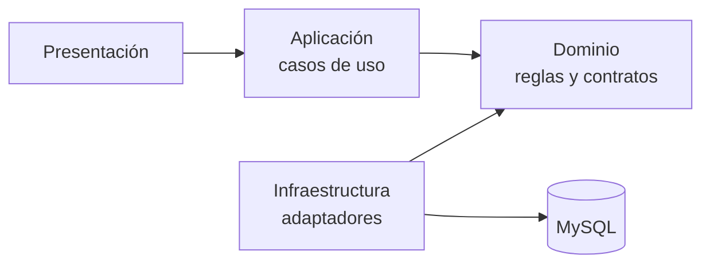

# Principios SOLID aplicados

Los principios se aplicarán gradualmente al diseño de los módulos. Los
ejemplos son propuestas relacionadas con el alcance de la constructora, no
afirmaciones sobre una implementación ya terminada.

| Principio | Aplicación en el sistema | Señal de incumplimiento a evitar |
|---|---|---|
| **S — Responsabilidad única (SRP)** | `RegistrarSalidaMaterial` coordina un caso de uso; `Material` valida sus propias reglas de stock; un repositorio persiste. | Un controlador que valida reglas, calcula stock, ejecuta SQL y genera reportes. |
| **O — Abierto/cerrado (OCP)** | Nuevos formatos de reporte pueden añadirse detrás de un contrato de exportación cuando el requisito exista. | Modificar un gran `switch` central en cada nueva variante de reporte. No se añade abstracción hasta que haya más de una variante real. |
| **L — Sustitución de Liskov (LSP)** | Todo adaptador que implemente un contrato de repositorio debe respetar sus resultados, errores y garantías transaccionales. | Un adaptador que devuelve éxito cuando no guardó el movimiento o que cambia silenciosamente el significado de una operación. |
| **I — Segregación de interfaces (ISP)** | Separar contratos de consulta, administración y movimientos si los consumidores requieren capacidades distintas. | Una interfaz enorme de almacén que obliga a los consumidores de lectura a implementar operaciones de escritura que no usan. |
| **D — Inversión de dependencias (DIP)** | Los casos de uso dependen de contratos de repositorio; los adaptadores de persistencia implementan esos contratos. | Importar `JpaRepository`, `EntityManager` o clases MySQL directamente desde el dominio o los casos de uso. |

## Dirección de dependencias propuesta

La dirección del código apunta hacia el dominio. En tiempo de ejecución el
caso de uso invoca un contrato y la implementación concreta de infraestructura
responde; esa colaboración no debe invertir la dependencia del código.

## Revisión

Antes de agregar una interfaz o patrón, comprobar que resuelve una variación o
acoplamiento real. La mantenibilidad se verificará con pruebas y revisión de
dependencias, no por el mero número de capas o abstracciones.
