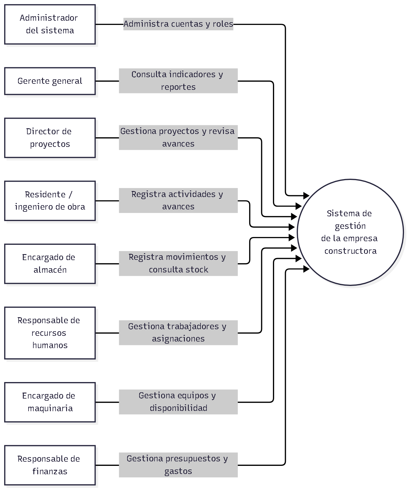

# Nivel 1 · Diagrama de contexto del sistema

> **Proyecto:** Sistema de gestión de una empresa constructora 
> **Modelo:** C4 · Nivel 1 de 4 · **Versión:** 1.0

---

## 1. Objetivo

Mostrar el sistema de gestión como una sola unidad, quiénes lo utilizan y qué
queda fuera de su frontera. Esta vista presenta el alcance a audiencias técnicas
y no técnicas, sin incluir tecnologías, infraestructura ni módulos internos.

| Aspecto | Descripción |
|---|---|
| Pregunta que responde | ¿Qué es el sistema, quién lo usa y con qué sistemas externos se integra? |
| Audiencia | Responsables del negocio, docentes, equipo de desarrollo y operaciones. |
| Qué no muestra | Tecnologías, servidores, bases de datos ni módulos internos. |
| Siguiente nivel | [Nivel 2 · Contenedores](./Nivel2-DiagramadeContenedores.md). |

## 2. Diagrama

Fuente Mermaid editable: [nivel1-contexto.mmd](../../img/fuentes/nivel1-contexto.mmd).

## 3. Personas

| Persona | Descripción | Qué hace en el sistema |
|---|---|---|
| Administrador del sistema | Responsable de usuarios y roles. | Administra las cuentas y asigna roles de acceso. |
| Gerente general | Responsable de supervisar la empresa. | Consulta indicadores, estado de proyectos y reportes consolidados. |
| Director de proyectos | Coordina los proyectos de construcción. | Gestiona proyectos y consulta actividades, avances y recursos. |
| Residente o ingeniero de obra | Supervisa la ejecución en campo. | Registra actividades y actualiza avances. |
| Encargado de almacén | Controla materiales y movimientos. | Registra entradas y salidas y consulta existencias. |
| Responsable de recursos humanos | Administra información del personal. | Registra trabajadores y gestiona asignaciones. |
| Encargado de maquinaria | Administra equipos de la empresa. | Mantiene su estado y asignación a proyectos. |
| Responsable de finanzas | Da seguimiento financiero a los proyectos. | Registra presupuestos y gastos asociados a obras. |

Los operarios, clientes y auditores se reconocen como participantes o
interesados del negocio, pero no tienen acceso directo definido en el alcance
inicial.

## 4. Sistemas

| Sistema | Tipo | Responsabilidad | Quién lo construye |
|---|---|---|---|
| Sistema de gestión de la constructora | Sistema en alcance | Centraliza proyectos, actividades, materiales, personal, maquinaria, finanzas, reportes y usuarios. | Equipo del proyecto. |

No se identifican sistemas externos obligatorios en el alcance inicial.
## 5. Relaciones

| Origen | Destino | Descripción | Protocolo |
|---|---|---|---|
| Administrador del sistema | Sistema de gestión | Administra usuarios y roles. | Interacción de usuario; detalle en Nivel 2. |
| Gerente general | Sistema de gestión | Consulta información resumida, indicadores y reportes. | Interacción de usuario; detalle en Nivel 2. |
| Director de proyectos | Sistema de gestión | Gestiona proyectos y consulta avances y recursos. | Interacción de usuario; detalle en Nivel 2. |
| Residente o ingeniero de obra | Sistema de gestión | Registra actividades y actualiza avances. | Interacción de usuario; detalle en Nivel 2. |
| Encargados y responsables de área | Sistema de gestión | Mantienen información de almacén, personal, maquinaria y finanzas. | Interacción de usuario; detalle en Nivel 2. |

En este nivel no se fijan protocolos entre personas y sistema. Los protocolos
de comunicación entre contenedores se describen en el Nivel 2.

## 6. Decisiones y supuestos

| # | Decisión o supuesto | Motivo |
|---|---|---|
| 1 | El sistema se dirige inicialmente a usuarios internos de la empresa. | El alcance define roles internos y no especifica acceso directo de clientes u otros interesados. |
| 2 | No se muestran sistemas externos conectados. | El alcance analizado no define integraciones obligatorias; agregarlas aquí supondría inventar requisitos. |
| 3 | Los reportes y el panel presentan información que ya administra el sistema. | Los requisitos funcionales no establecen fuentes externas de datos. |

### Pendientes por definir

| Tema | Detalle |
|---|---|
| Acceso de interesados externos | Confirmar si clientes o auditores necesitarán consultar información directamente. |
| Integraciones externas | Incorporar un sistema externo solo cuando se valide su necesidad, propietario, datos intercambiados y dirección de comunicación. |
| Matriz de acceso | Precisar los permisos por rol y operación durante el diseño detallado. |

## 7. Trazabilidad

- [Actores del sistema](../01-analisis-de-sistema/01-actores.md)
- [Requisitos funcionales](../01-analisis-de-sistema/03-requisitos-funcionales.md)
- [Nivel 2 · Contenedores](./Nivel2-DiagramadeContenedores.md)
