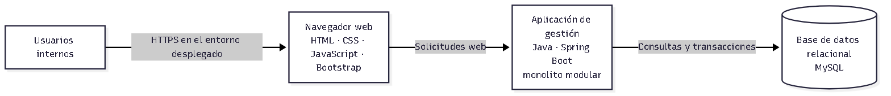

# Nivel 2 · Diagrama de contenedores

> **Proyecto:** Sistema de gestión de una empresa constructora 
> **Modelo:** C4 · Nivel 2 de 4 · **Versión:** 1.0

---

## 1. Objetivo

Abrir la caja del sistema del Nivel 1 y mostrar las aplicaciones y almacenes de
datos propuestos, las tecnologías previstas y sus comunicaciones. En C4, un
contenedor es una unidad ejecutable o un almacén de datos; no significa
necesariamente una imagen Docker.

| Aspecto | Descripción |
|---|---|
| Pregunta que responde | ¿De qué piezas ejecutables se compone el sistema y cómo se comunican? |
| Audiencia | Arquitectura, desarrollo y operaciones. |
| Nivel anterior | [Nivel 1 · Contexto del sistema](./Nivel1-DiagramadeContextodelSistema.md). |
| Siguiente nivel | [Nivel 3 · Componentes](./Nivel3-Diagrama-de-Componentes.md). |

## 2. Diagrama

Fuente Mermaid editable: [nivel2-contenedores.mmd](../../img/fuentes/nivel2-contenedores.mmd).

## 3. Contenedores

| Contenedor | Tecnología prevista | Responsabilidad | Datos que maneja |
|---|---|---|---|
| Navegador web | HTML, CSS, JavaScript y Bootstrap | Presenta formularios, consultas, panel y reportes a los usuarios internos. | Estado temporal de la interfaz; no es persistencia del negocio. |
| Aplicación de gestión | Java, Spring Boot y Spring Security | Expone las funciones web, aplica autorización, ejecuta los casos de uso y coordina los módulos. Se propone como monolito modular con Clean Architecture. | Datos operativos durante la ejecución; delega la persistencia en adaptadores. |
| Base de datos relacional | MySQL | Conserva la información central y sus relaciones y soporta transacciones. | Proyectos, actividades, materiales y movimientos, trabajadores y asignaciones, maquinaria, presupuestos, gastos, usuarios y roles. |

Las tecnologías se proponen en el caso y quedan sujetas a confirmación. El
navegador representa el entorno de interacción; no se afirma que la interfaz
tenga un despliegue independiente del backend. No se han definido caché,
almacenamiento separado ni proveedores externos.

## 4. Relaciones

| Origen | Destino | Descripción | Protocolo |
|---|---|---|---|
| Usuarios internos | Navegador web | Acceden a la interfaz y realizan las funciones autorizadas para su rol. | Interacción de usuario. |
| Navegador web | Aplicación de gestión | Envía solicitudes web y presenta los resultados. | HTTP; HTTPS esperado en un entorno desplegado. |
| Aplicación de gestión | Base de datos relacional | Consulta y persiste información y ejecuta operaciones transaccionales mediante adaptadores. | Acceso relacional; protocolo y configuración por confirmar. |

El uso de HTTPS es una expectativa para el despliegue, no una configuración ya
implementada. No se agregan llamadas a sistemas externos porque no están
definidas en el alcance.

## 5. Decisiones arquitectónicas reflejadas

| Decisión | Alternativa no propuesta | Motivo |
|---|---|---|
| Un contenedor de aplicación como monolito modular. | Microservicios desplegados de forma independiente. | No se han identificado necesidades de escalado independiente, equipos separados o despliegue distribuido. |
| Persistencia relacional centralizada en MySQL, tecnología prevista. | Almacenes independientes por módulo o una base no relacional como repositorio principal. | Los módulos relacionan proyectos, actividades, recursos y finanzas; se requieren relaciones e integridad transaccional. |
| Interfaz web utilizada desde el navegador. | Presuponer una SPA o un despliegue frontend separado. | El alcance prevé una interfaz web, pero no define una SPA ni exige separar su despliegue. |
| Sin caché ni integraciones externas en la propuesta inicial. | Añadir Redis, pasarela, ERP u otros proveedores. | No existen requisitos que justifiquen esos componentes en el alcance confirmado. |

## 6. Seguridad entre contenedores

| Comunicación | Medida propuesta |
|---|---|
| Navegador → Aplicación | Usar HTTPS en el entorno desplegado; los detalles de sesión o token quedan por definir con la implementación. |
| Aplicación → Base de datos | Restringir el acceso al servicio de aplicación, gestionar credenciales fuera del código y definir permisos mínimos. |
| Operaciones protegidas | Validar identidad y permisos en el servidor; ocultar controles en la interfaz no sustituye la autorización. |

## 7. Pendientes por definir

- Confirmar versiones y configuración final de Java, Spring Boot, Spring Security y MySQL.
- Definir alojamiento, topología de red, credenciales y gestión de secretos.
- Definir política de respaldo y restauración y comprobarla en el entorno objetivo.
- Precisar la estrategia de autenticación y el mecanismo de sesión o token.

## 8. Trazabilidad

- [Decisiones arquitectónicas](../01-analisis-de-sistema/07-decisiones-arquitectonicas.md)
- [Estilo arquitectónico](../02-arquitectura-software/estilo-arquitectonico.md)
- [Nivel 3 · Componentes](./Nivel3-Diagrama-de-Componentes.md)
