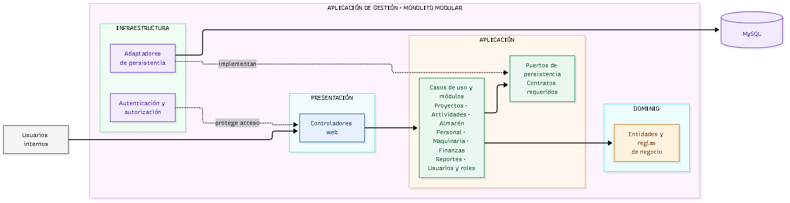

# Nivel 3 · Diagrama de componentes

> **Proyecto:** Sistema de gestión de una empresa constructora 
> **Contenedor detallado:** Aplicación de gestión 
> **Modelo:** C4 · Nivel 3 de 4 · **Versión:** 1.0

---

## 1. Objetivo

Abrir el contenedor Aplicación de gestión del Nivel 2 y mostrar sus componentes
lógicos, responsabilidades y colaboraciones. Los módulos de negocio son
componentes del monolito; cada módulo mantiene los límites de Clean
Architecture descritos para el sistema.

| Aspecto | Descripción |
|---|---|
| Pregunta que responde | ¿Cómo se divide la aplicación y qué responsabilidad tiene cada componente? |
| Audiencia | Arquitectura y desarrollo. |
| Qué es un componente | Una unidad lógica con responsabilidad clara, accesible mediante contratos definidos. |
| Nivel anterior | [Nivel 2 · Contenedores](./Nivel2-DiagramadeContenedores.md). |
| Siguiente nivel | [Nivel 4 · Código / diseño interno](./Nivel4-DiagramadeCodigo.md). |

## 2. Diagrama

Fuente Mermaid editable: [nivel3-componentes.mmd](../../img/fuentes/nivel3-componentes.mmd).

## 3. Componentes

| Componente | Responsabilidad | Funcionalidades principales |
|---|---|---|
| Presentación web | Punto de entrada y salida para usuarios internos. | Recibe solicitudes, transforma entradas/salidas y presenta resultados. |
| Seguridad y autorización | Protege las operaciones según la identidad y rol. | Autenticación y validación de permisos en el servidor mediante el mecanismo técnico seleccionado. |
| Proyectos y actividades | Gestiona los proyectos, actividades y su avance. | Registrar y consultar proyectos y actividades; actualizar avances. |
| Materiales y almacén | Gestiona materiales y movimientos. | Registrar materiales, entradas y salidas; consultar existencias por movimientos. |
| Personal y asignaciones | Mantiene trabajadores y su relación con proyectos o actividades. | Registrar trabajadores y gestionar asignaciones. |
| Maquinaria | Mantiene los equipos, su estado y asignación. | Registrar y consultar maquinaria; actualizar estado y asignación. |
| Finanzas | Gestiona la información financiera de las obras. | Registrar presupuestos y gastos por proyecto. |
| Reportes e información general | Construye vistas de consulta consolidadas a partir de datos existentes. | Generar reportes y presentar el panel principal; no es dueño de los datos operativos. |
| Usuarios y roles | Administra cuentas y roles de acceso. | Registrar usuarios y asignar roles. |
| Puertos de persistencia | Contratos requeridos por los casos de uso para consultar y guardar información. | Definir operaciones de repositorio sin incluir SQL ni dependencias de MySQL/Spring Data. |
| Adaptadores de persistencia | Implementa los puertos requeridos por los módulos. | Traduce contratos a operaciones transaccionales sobre MySQL. |

Los componentes son una descomposición lógica propuesta; sus nombres no
representan carpetas de código existentes.

## 4. Relaciones entre componentes

| Origen | Destino | Descripción | Tipo de comunicación |
|---|---|---|---|
| Presentación web | Módulos de negocio | Invoca los casos de uso expuestos por la aplicación. | Llamada dentro del proceso. |
| Seguridad y autorización | Operaciones protegidas | Autoriza la solicitud antes de permitir que el caso de uso continúe. | Verificación en el servidor. |
| Proyectos y actividades | Módulos relacionados | Colabora mediante identificadores y contratos explícitos cuando necesita datos de recursos. | Llamada por interfaz definida. |
| Reportes | Módulos de negocio | Consulta datos de origen para construir proyecciones y agregados. | Puerto o consulta explícita. |
| Casos de uso de cada módulo | Puertos de persistencia | Declaran y usan las operaciones externas requeridas. | Dependencia de código hacia una abstracción. |
| Adaptadores de persistencia | Puertos de persistencia | Implementan los contratos requeridos por la aplicación. | Implementación del contrato; dirección de código hacia adentro. |
| Adaptadores de persistencia | MySQL | Ejecutan consultas y transacciones. | Acceso relacional, detalle técnico por confirmar. |

## 5. Relaciones con contenedores y sistemas externos

| Componente | Destino | Descripción | Protocolo / patrón |
|---|---|---|---|
| Adaptadores de persistencia | Base de datos MySQL | Lectura y escritura de los datos del sistema. | Adaptador / Repository; acceso relacional. |
| Módulos de negocio | Sistemas externos | No se definen integraciones externas en el alcance inicial. | No aplica. |

## 6. Reglas del monolito modular y Clean Architecture

| # | Regla | Motivo |
|---|---|---|
| 1 | Los módulos se ejecutan y despliegan juntos como una aplicación. | Mantener la simplicidad operativa del monolito inicial. |
| 2 | Un módulo colabora con otro mediante contratos explícitos, no accediendo a detalles internos. | Reducir el acoplamiento entre componentes. |
| 3 | Un módulo no consulta ni modifica directamente las tablas que pertenecen a otro módulo. | Mantener la propiedad y consistencia de los datos. |
| 4 | Cada módulo organiza Presentación, Aplicación, Dominio e Infraestructura según corresponda a sus responsabilidades. | Mantener las reglas del negocio independientes de tecnologías externas. |
| 5 | Aplicación declara los puertos que necesita; Infraestructura proporciona sus implementaciones. | Invertir la dependencia respecto de la persistencia y otros mecanismos técnicos. |
| 6 | Dominio no importa Spring, MySQL ni tipos del transporte web. | Proteger las reglas del negocio frente a cambios tecnológicos. |
| 7 | Una operación que modifica datos relacionados se coordina desde el caso de uso y persiste de forma consistente. | Evitar estados parciales. |

## 7. Trazabilidad

- Los componentes cubren [RF01–RF16](../01-analisis-de-sistema/03-requisitos-funcionales.md).
- La organización de capas se detalla en [Estilo arquitectónico](../02-arquitectura-software/estilo-arquitectonico.md).
- La colaboración de almacén se detalla en [Nivel 4 · Código / diseño interno](./Nivel4-DiagramadeCodigo.md).
