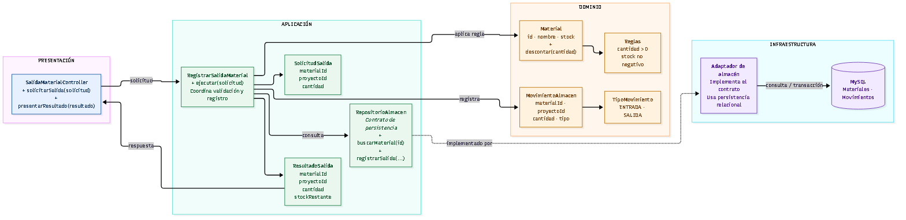
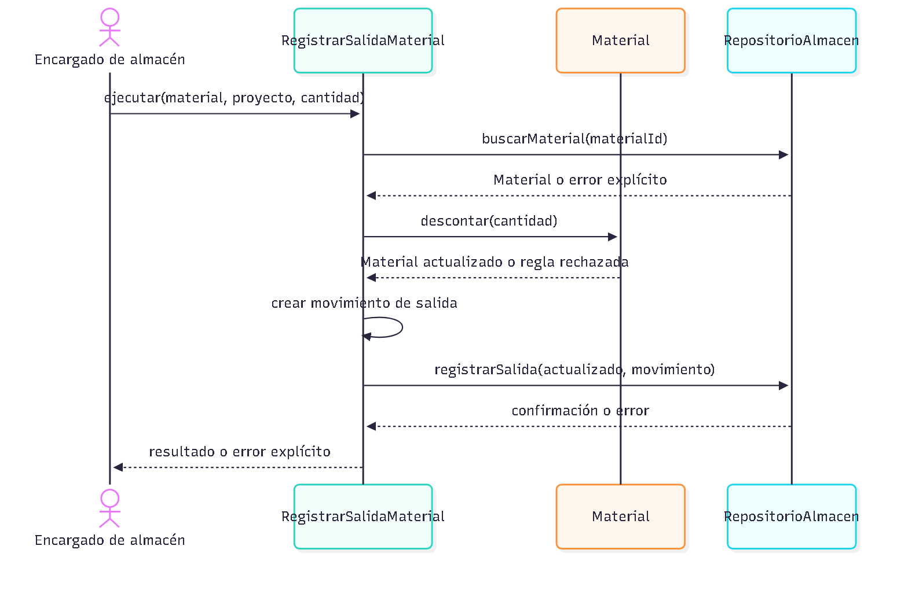

# C4 - Nivel 4: código / diseño interno

## Alcance

Este nivel detalla el diseño interno propuesto del componente de almacén
mediante el caso de uso de salida de material. El diagrama de clases y la
secuencia son documentación de diseño; no describen código implementado.

## Modelo de clases

Fuente Mermaid editable: [nivel4-clases.mmd](../../img/fuentes/nivel4-clases.mmd).

## Secuencia resumida

Fuente Mermaid editable: [nivel4-secuencia.mmd](../../img/fuentes/nivel4-secuencia.mmd).

## Reglas y garantías

- La cantidad debe ser mayor que cero.
- El material y el proyecto deben existir.
- El stock resultante no puede ser negativo.
- La salida y la reducción de stock deben persistirse atómicamente en la
  implementación real.
- Un error debe propagarse como rechazo explícito; nunca debe convertirse en
  una respuesta de éxito.

En una futura fase de implementación, el adaptador de persistencia deberá
proteger la transacción ante salidas concurrentes y registrar el movimiento
junto con la actualización de stock. Esas garantías todavía no se han
implementado ni probado en esta etapa documental.
